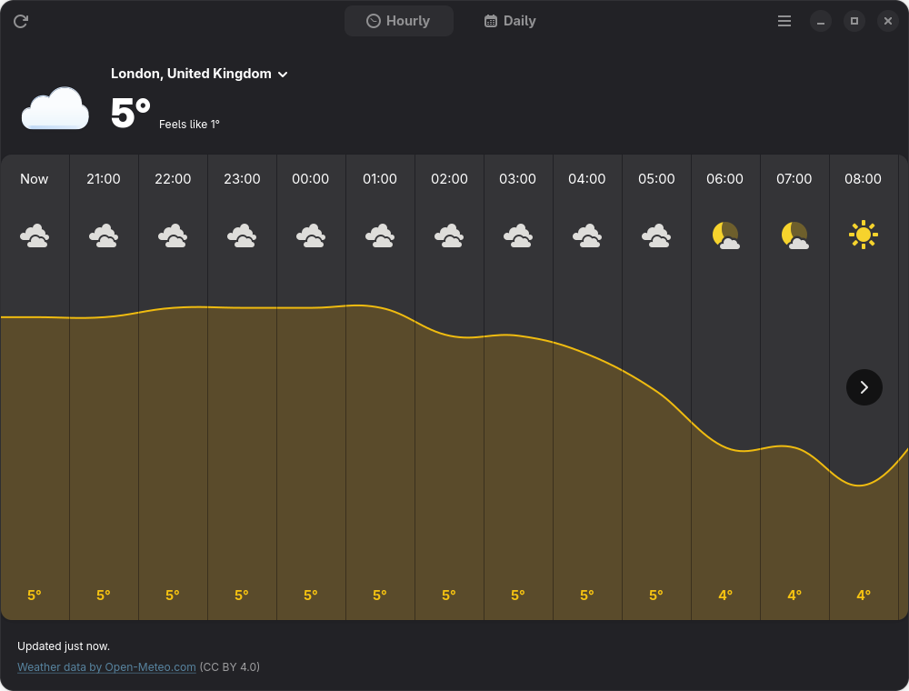
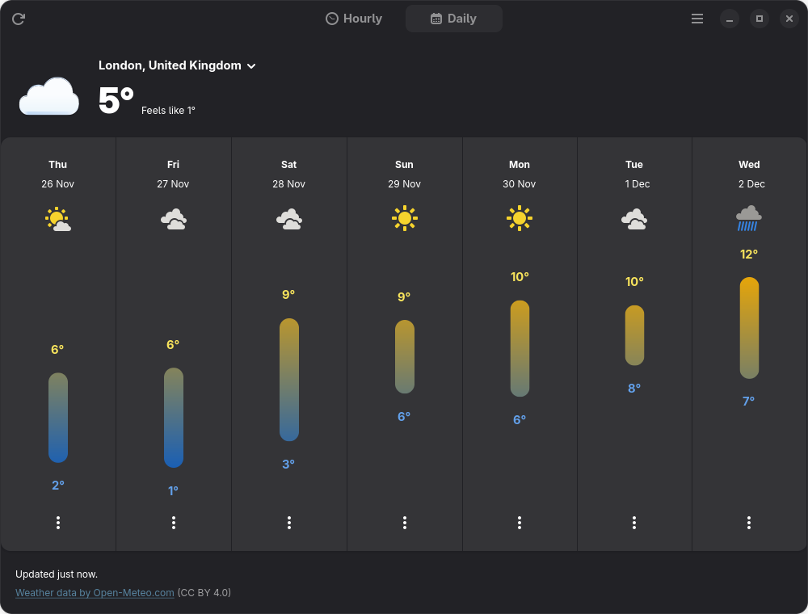
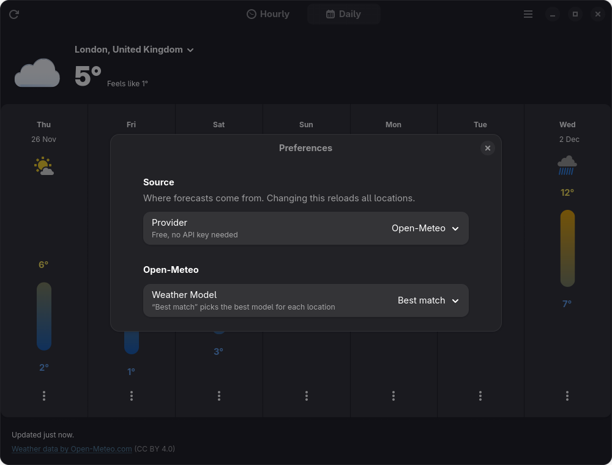

# Brolly

Weather forecasts for GNOME, from the provider you choose.

<br clear="left">

Brolly is a fork of [GNOME Weather](https://apps.gnome.org/Weather/). It keeps
the familiar app and lets you pick where your forecasts come from. It also
uses your real town or village for your location, not just the nearest big
city.



## Features

- **Choose a weather provider** (Menu → Preferences, or <kbd>Ctrl</kbd>+<kbd>,</kbd>):

  | Provider | API key | Notes |
  | --- | --- | --- |
  | [Open-Meteo](https://open-meteo.com/) | no | Hourly data for 8 days. You can pick the weather model (ECMWF, UK Met Office, DWD ICON, …). |
  | [Met Office DataHub](https://datahub.metoffice.gov.uk/) | yes (free tier) | Subscribe to **Global spot**, free plan (360 calls/day). Hourly for 48 h, then three-hourly to 7 days. |
  | [OpenWeatherMap One Call 3.0](https://openweathermap.org/api/one-call-3) | yes | Hourly for 48 h, then built from daily data. |
  | libgweather | no | What GNOME Weather uses. Each backend (METAR, MET Norway, OpenWeatherMap, NWS) can be switched on or off. |

- **Your real location.** The automatic location uses GeoClue's position
  (rounded to about 1 km) and is named from OpenStreetMap, so you see your
  town or village. When GeoClue only has a rough position, Brolly falls back
  to the nearest big city.
- **Search any town or village**, not only the cities in libgweather's
  database.
- **Shows where the forecast comes from.** When a provider forecasts for a
  nearby site, Brolly says so, for example "Forecast for Heanor, 1.4 km away".
- **API keys are kept in your keyring**, not in plain settings.
- **Panel weather.** The optional [Brolly Panel Weather](shell-extension/)
  GNOME Shell extension makes the weather in the calendar menu use Brolly's
  provider and places.
- **Imports GNOME Weather's saved places** on first run, when GNOME Weather's
  settings are present (not inside the Flatpak sandbox).

<p>
  
  
</p>

## Install

### Flatpak

Download `Brolly-<version>.flatpak` from the
[latest release](https://github.com/jdtanner/brolly/releases/latest), then:

```
flatpak install --user Brolly-0.1.0.flatpak
```

The app needs the GNOME 51 runtime from Flathub. If that isn't installed,
Flatpak offers to install it.

### Panel extension

Download `brolly-panel@jdtanner.github.io.zip` from the same release, then:

```
gnome-extensions install brolly-panel@jdtanner.github.io.zip
```

Log out and back in (needed on Wayland), then run
`gnome-extensions enable brolly-panel@jdtanner.github.io`.

### From source

You need Meson, the GTK 4, libadwaita, GJS (≥ 1.89.1), libgweather 4,
GeoClue, libsoup 3 and libsecret development packages, and TypeScript.

```
git clone --recurse-submodules https://github.com/jdtanner/brolly.git
cd brolly
npm ci                                   # provides tsc
export PATH="$PWD/node_modules/.bin:$PATH"
meson setup _build --prefix=/usr/local
meson compile -C _build && meson compile -C _build   # twice: see below
sudo meson install -C _build
```

The build compiles the TypeScript and then bundles it. On the first
`meson compile` after a change, the bundle may still hold the previous build
(an upstream build quirk), so run it twice.

To build the Flatpak yourself:

```
flatpak-builder --user --install --force-clean _flatpak io.github.jdtanner.Brolly.json
```

## Privacy

- Weather providers receive only coordinates, rounded to about 1 km.
- OpenStreetMap Nominatim receives the same rounded coordinates for your
  automatic location, to look up its name. Results are cached for 30 days.
- Place search sends only the text you type, to Open-Meteo's geocoding API.
- Responses are cached in `~/.cache/brolly`.

## How it works

The UI talks to `WeatherInfo` (`src/shared/weatherInfo.ts`) instead of
`GWeather.Info`. `WeatherInfo` keeps the GWeather.Info methods the app uses.
`GWeatherInfoAdapter` wraps libgweather, and `RemoteInfo`/`DataInfo` hold
data fetched by the providers in `src/shared/providers.ts`. To add a
provider, write a `Fetcher` that returns metric `WeatherSample`s and register
it in `getProviders()` and `buildInfo()`.

The background service (`io.github.jdtanner.Brolly.BackgroundService`)
provides Activities search results and the
`io.github.jdtanner.Brolly.Forecast` D-Bus interface that the panel
extension uses.

## Credits and licence

Brolly is based on GNOME Weather by Giovanni Campagna, Christopher Davis and
the GNOME contributors, and keeps its translations. Brolly is not affiliated
with or endorsed by the GNOME Foundation.

Licensed under the GNU General Public License, version 2 or later. See
[COPYING.md](COPYING.md).

Weather data comes from the provider you choose. Their terms and
attribution apply, and Brolly shows the attribution in the app.
